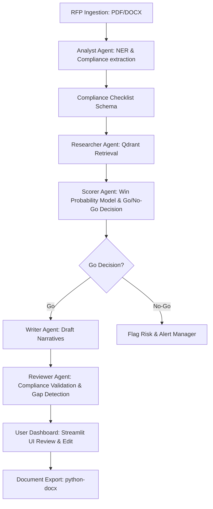

# Implementation Plan: Project Antigravity
## Enterprise AI-Powered Bid & Proposal Response Engine

Project Antigravity is a layout-aware, multi-agent RAG (Retrieval-Augmented Generation) system designed to ingest complex multi-page RFPs, automatically match them against an organization's historic capability library, evaluate win probability, and auto-draft fully compliant technical proposals.

---

## 1. System Architecture & Component Mapping

The platform is designed using a decoupled microservices architecture containerized completely via Docker.

```text
              ┌─────────────────────────────────────────┐
              │          Streamlit / Next.js UI         │
              └─────────────────────────────────────────┘
                                   │  ▲
                      REST / Uplink │  │ JSON Payloads
                                   ▼  │
              ┌─────────────────────────────────────────┐
              │               FastAPI API               │
              └─────────────────────────────────────────┘
                 │            │            │            │
      Parse Requests │            │ DB Queries │            │ Agent Processing
                     ▼            │            ▼            ▼
┌───────────────────────────┐       │ ┌───────────────────────────┐
│   LlamaParse / PyMuPDF    │       │ │      SQLite Database      │
└───────────────────────────┘       │ └───────────────────────────┘
▼
┌───────────────────────────────────────────┐
│  Qdrant / Pinecone (Vector Database)      │
└───────────────────────────────────────────┘
```

### Core Architecture Layers:
1. **Frontend Presentation:** Streamlit (Prototype Tier) or Next.js running on port `8501`/`3000`.
2. **Orchestration & Backend Services:** Async FastAPI core running on port `8000`.
3. **Multi-Agent Execution Layer:** LangGraph workflow running embedded inside the FastAPI worker threads.
4. **Knowledge Store Database:** SQLite (Relational transactional/workspace data) + Qdrant (Vector Engine for Capability Library RAG).

---

## 2. Dataset Ingestion & Target Schemas

The application ingests and integrates four key datasets to power its extraction, retrieval, and scoring modules:

### A. RFP / Tender Documents (PDF / DOCX)
- **Ingestion Pipeline:** Uses **LlamaParse** (for high-fidelity tables/layouts retention) and **PyMuPDF** (fallback parser). 
- **Parsing Schema:**
  ```json
  {
    "rfp_id": "uuid-string",
    "metadata": {
      "title": "Project Name / RFP Title",
      "issuer": "Client Organization",
      "submission_deadline": "YYYY-MM-DD",
      "estimated_budget": 1250000.00
    },
    "requirements": [
      {
        "req_id": "REQ-001",
        "section": "Technical Proposal Requirements",
        "description": "Must provide proof of ISO 27001 certification.",
        "is_mandatory": true
      }
    ],
    "questions": [
      {
        "question_id": "Q-01",
        "prompt": "Describe your company's experience in deploying cloud infrastructures."
      }
    ]
  }
  ```

### B. Company Capability Library (50 Records)
- **Sheet Name:** `PS1 – Capability Library`
- **Data Columns:** `Cap ID`, `Domain`, `Project Summary`, `Certification`, `Year Completed`, `Contract Value`, `Duration (months)`, `Client Type`.
- **Storage Strategy:** Parsed metadata fields are stored in a SQLite table; descriptive text fields (`Project Summary`) are vectorized using `text-embedding-3-small` and saved in a **Qdrant** collection for hybrid semantic search.
- **Record Schema (SQLite/Qdrant):**
  ```json
  {
    "cap_id": "CAP-001",
    "domain": "Cybersecurity",
    "project_summary": "Project 1: Cybersecurity deployment for client",
    "certification": "ISO 27001",
    "year_completed": 2023,
    "contract_value": "PKR 15M",
    "duration_months": 34,
    "client_type": "International"
  }
  ```

### C. Historical Bid Outcomes (120 Bids)
- **Sheet Name:** `PS1 – Bid History`
- **Data Columns:** `Bid ID`, `Client`, `Sector`, `Budget`, `Score (%)`, `Outcome`, `Response Time (hrs)`, `Compliance %`, `Doc Pages`, `Gaps Found`, `Bid Manager`, `Submission Date`.
- **Usage:** Preloaded into a SQLite table (`bid_history`) for calculating win rates, calculating score correlations, and training the win-probability classification model.
- **Record Schema (SQLite):**
  ```json
  {
    "bid_id": "BID-0001",
    "client": "FWO",
    "sector": "Construction",
    "budget": "PKR 22M",
    "score_percentage": 92,
    "outcome": "Win",
    "response_time_hours": 94,
    "compliance_percentage": 75,
    "doc_pages": 144,
    "gaps_found": 2,
    "bid_manager": "Sara Malik",
    "submission_date": "2025-02-22"
  }
  ```

### D. Evaluation Criteria Taxonomy (15+ Items)
- **Usage:** Custom-seeded reference checklist taxonomy stored in SQLite to map standard parameters (e.g., Technical Compliance, Pricing, Past Performance, SLA Guarantees) against extracted RFP criteria.

---

## 3. Multi-Agent Proposal Flow (LangGraph Workflow)

Proposal generation is orchestrated as a directed acyclic graph (DAG) via **LangGraph**, where specialized agents refine the outputs:



### LangGraph Agent Roles:
1. **Analyst Agent:** Extracts compliance targets, deadlines, budgets, and question lists. Automatically flags mandatory requirements.
2. **Researcher Agent:** Performs hybrid search (Semantic embeddings via Qdrant + Lexical/BM25 queries on SQLite) to find matching capability summaries, credentials, and case studies.
3. **Scorer Agent:** Uses historical outcomes to evaluate target win probability and flags the GO/NO-GO recommendation.
4. **Writer Agent:** Multi-turn drafting agent that maps matched capability evidence to the proposal questions to generate compliant narrative drafts.
5. **Reviewer Agent:** Performs automated verification checks, validating the drafted response against compliance requirements and highlighting content/evidence gaps.

---

## 4. Win-Probability & Opportunity Scoring Logic

To aid the GO/NO-GO decision-making process, a heuristic scoring engine integrates data from the 120 historical bid outcomes.

### The Opportunity Score Formula:
$$Score = W_{budget} \cdot S_{budget} + W_{capability} \cdot S_{capability} + W_{history} \cdot S_{history} - W_{competitor} \cdot N_{competitors}$$

- **Budget Fit ($S_{budget}$):** Computes score based on how close the target RFP budget aligns with historic winning project values in the same sector.
- **Capability Score ($S_{capability}$):** Calculated from semantic similarity scores of matched records in the Company Capability Library.
- **Historical Rate ($S_{history}$):** The organization's win rate in the target industry vertical (drawn from past outcomes).
- **Competitor Count Penalty ($N_{competitors}$):** Penalty scaling with the number of known competitor participants.
- **Threshold Rule:** Opportunities scoring **$\ge$ 65%** are recommended as a **GO**; scores below this trigger a **NO-GO** alert detailing key risk factors.

---

## 5. Workspace & UI Specifications

The **Streamlit** front-end is divided into modular dashboard panels:

1. **Workspace Hub (Separate View per RFP):**
   - Workspace isolation to prevent cross-contamination. 
   - A centralized directory containing uploaded RFPs, drafts, and compliance audits for each tender.
2. **Opportunity Dashboard & GO/NO-GO Indicator:**
   - Display card showing the overall Win-Probability percentage.
   - Distinctive visual badges for GO / NO-GO recommendations.
3. **Compliance Checklist Grid:**
   - Interactive table listing mandatory criteria.
   - Pass/Fail flags mapped against internal capabilities.
   - Interactive overrides for manual adjustments.
4. **Narrative Editor & Export:**
   - Split-screen editor showing the generated AI draft side-by-side with matched source evidence.
   - Re-draft button to refine individual proposal sections.
   - One-click docx export utilizing custom Word templates (`python-docx`).

---

## 6. Team Member Work Breakdown Matrix

| Role | Primary Objectives | Target Deliverables |
| :--- | :--- | :--- |
| **Engineer 1: Data & Pipeline** | Layout extraction & vector data ingestion | Custom ingestion pipeline script, Markdown text chunking models, Hybrid Vector Search API hooks. |
| **Engineer 2: Agentic Logic** | Intelligence core orchestration | LangGraph routing graph containing Analyst, Researcher, Writer, and Reviewer Agent code loops. |
| **Engineer 3: UI & Scoring** | User interaction & statistical metrics | Frontend workspace dashboard view, Win-probability calculation modules, Document export converters (`python-docx`). |

---

## 7. Docker Containerization Specification

To isolate dependencies across your 3-person team, the entire platform is defined using a multi-container arrangement.

### `Dockerfile` (Place inside `/backend` directory)
```dockerfile
FROM python:3.11-slim

# System updates and file parsing dependencies
RUN apt-get update && apt-get install -y \
    build-essential \
    curl \
    && rm -rf /var/lib/apt/lists/*

WORKDIR /app

# Install dependencies separately to leverage Docker cache layers
COPY requirements.txt .
RUN pip install --no-cache-dir -r requirements.txt

# Copy backend application source
COPY . .

EXPOSE 8000

CMD ["uvicorn", "main:app", "--host", "0.0.0.0", "--port", "8000", "--reload"]
```